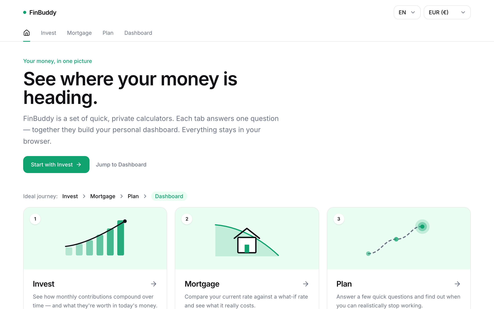
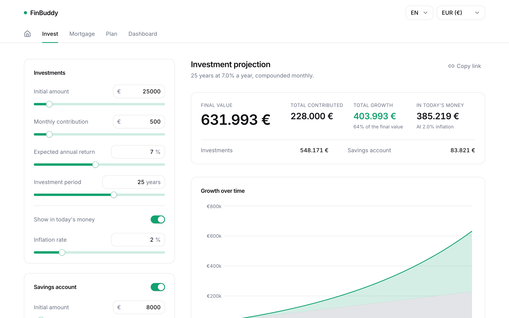
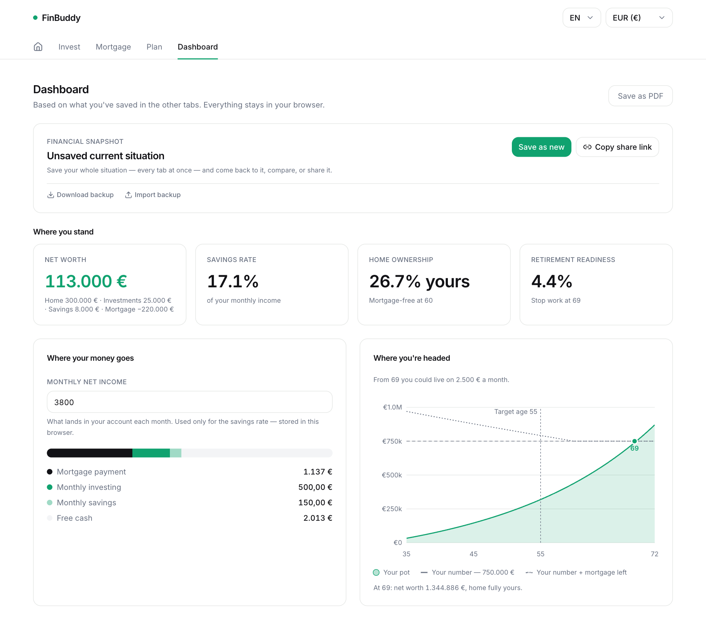

# FinBuddy

Three quick calculators that add up to one picture of your finances: **invest**, **mortgage** and **when can I stop working**. No sign-up, no backend — everything runs in your browser and is saved locally.

**Live app**: https://finfinbuddy.lovable.app

<p align="center">
  
</p>

<table>
  <tr>
    <td width="50%"></td>
    <td width="50%"></td>
  </tr>
</table>

*Screenshots use sample data.*

## What it does

| Tab | Question it answers |
| --- | --- |
| **Invest** | How do monthly contributions compound over time, and what are they worth in today's money? |
| **Mortgage** | What does a different rate really cost? Compare your current rate with a what-if, solve for term or payment, add one-off or yearly extra payments. |
| **Plan** | A few quick questions to find out when you can realistically stop working. |
| **Dashboard** | Where you stand today (balance sheet) and where you're headed: two retirement milestones — *live on X from age A1* and *debt-free from age A2* (mortgage included). Export as a 2-page PDF. |

Also: named snapshots of all tabs, shareable links, multiple currencies, English and Czech UI.

## Privacy

There is no server-side storage and no accounts. Your numbers live in `localStorage` in your own browser and never leave it (shared links encode the scenario in the URL).

## Tech stack

- [TanStack Start](https://tanstack.com/start) + TanStack Router (file-based routes in `src/routes`)
- React 19, TypeScript, Vite
- Tailwind CSS 4, Radix UI / shadcn-style components
- Recharts for charts
- Deployed on Lovable (Cloudflare Workers)

## Project layout

```
src/
  routes/       one file per tab (invest, mortgage, plan, dashboard)
  components/   UI, per-tab components, shadcn primitives in ui/
  lib/          the maths and state: finance.ts, retirement.ts, plan.ts,
                dashboard.ts, snapshots.ts, i18n.tsx, currency.tsx
docs/superpowers/specs/   design notes for larger changes
```

The retirement maths in `src/lib/retirement.ts` is shared by Plan and Dashboard so the two always agree.

## Development

You need Node.js and npm (or Bun).

```sh
git clone https://github.com/trenknerpeter/finfinbuddy.git
cd finfinbuddy
npm i
npm run dev
```

Other scripts: `npm run build`, `npm run lint`, `npm run format`.

## Built with Lovable

This project is connected to [Lovable](https://lovable.dev): changes made in the [Lovable editor](https://lovable.dev/projects/64f4564c-cd21-4a34-8b12-80aa9da53e94) are committed to this repository, and pushes to `main` sync back into Lovable. Please avoid rewriting published git history.

## Disclaimer

FinBuddy is an educational planning tool, not financial advice. Projections rest on the assumptions you enter; real returns, rates and inflation will differ.

## License

[MIT](LICENSE)
